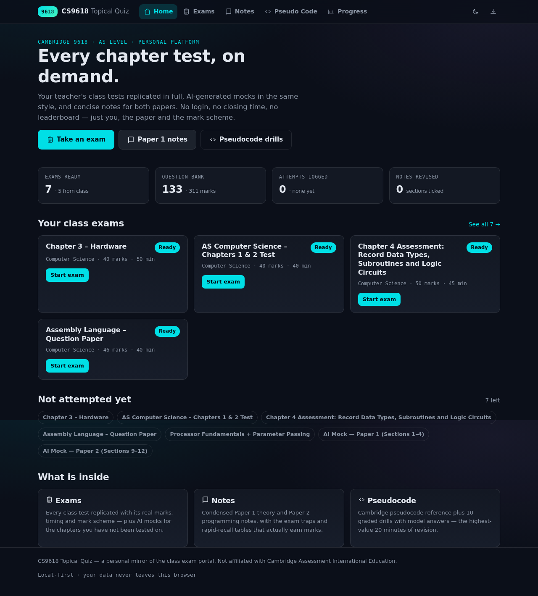
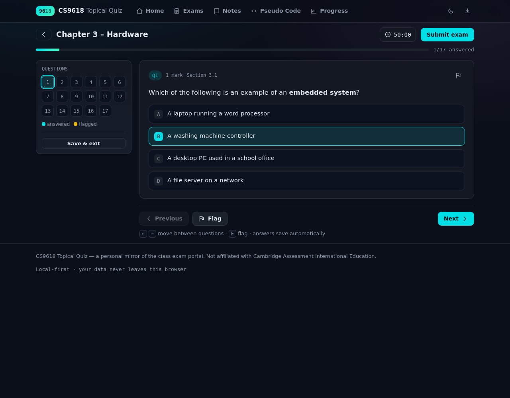
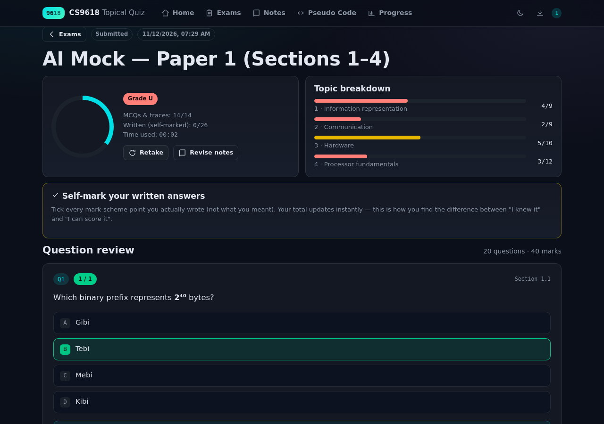
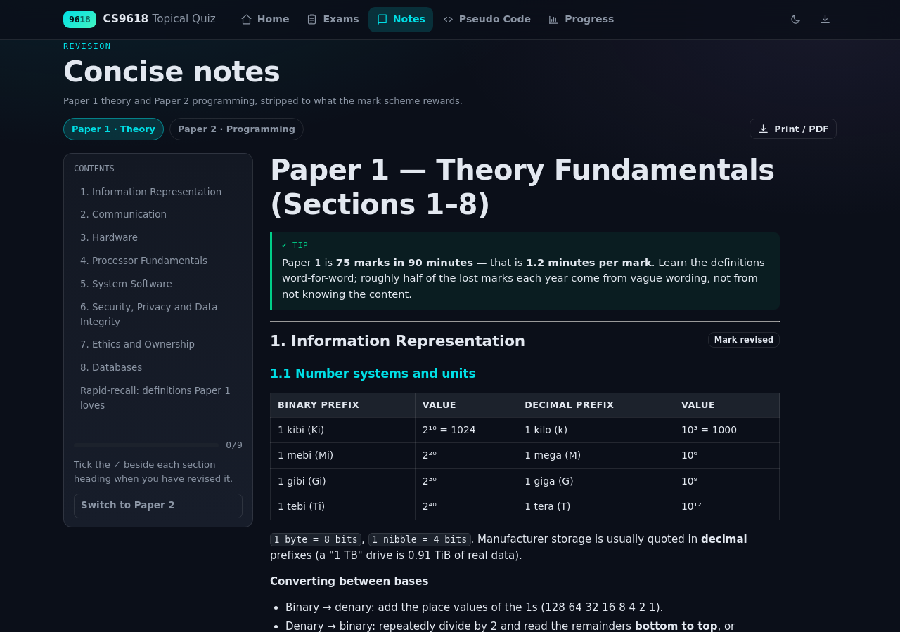
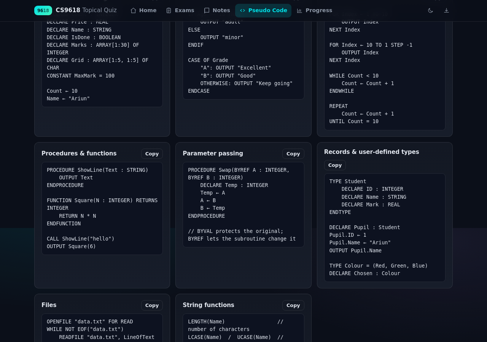

# CS9618 Topical Quiz

A personal, offline-first exam platform for **Cambridge International AS Level Computer Science (9618)**.
It mirrors the class exam portal ([shalgalt.online](https://www.shalgalt.online)) — same dark card layout, same
"marks · duration / result available / ready" language — but rebuilt for one student:

- **Every class test replicated**, with the real marks, timing and a mark scheme, so you can re-take it any time, as many times as you like.
- **AI-generated mocks** in the same style for the chapters your teacher has not tested yet.
- **Concise notes** for Paper 1 (theory) and Paper 2 (pseudocode/programming), with the exam traps and rapid-recall tables.
- **Pseudocode training**: Cambridge syntax reference + 10 graded drills with model answers.
- **Progress tracking**: marks, percentages, per-topic mastery, weakest-topic ranking, attempt history.
- **No login, no server, no trackers.** Everything runs from static files; your answers and results live in your browser.



| Exam player | Result & self-marking |
|---|---|
|  |  |

| Notes | Pseudocode drills |
|---|---|
|  |  |

---

## Quick start

Open the platform by double-clicking **`index.html`** — it works straight from the filesystem, offline,
from an USB stick, from your phone. Nothing to install.

For the best experience (and so links like `notes.html?paper=paper-2` keep their query strings), serve it locally:

```bash
# option 1 — Python (already installed on macOS/Linux)
npm run serve          # → http://localhost:8080

# option 2 — Node
npx serve .
```

---

## What is in the box

| Page | What it does |
|---|---|
| `index.html` | Dashboard: exam cards, question-bank stats, weakest topics, "not attempted yet" |
| `exams.html` | All exams with search + filters (teacher / AI, Paper 1 / Paper 2, chapter) |
| `exam.html?id=…` | The exam player: timer, question navigator, flags, autosave, resume, auto-submit |
| `result.html?attempt=…` | Score ring, grade, topic breakdown, **self-marked** written answers, full review with "why" |
| `notes.html?paper=…` | Paper 1 / Paper 2 notes, contents sidebar, "mark revised" per section, print to PDF |
| `code.html` | Cambridge pseudocode reference (copy buttons) + 10 drills with hidden model answers |
| `progress.html` | Attempt history, average, topic mastery bars, exam coverage, backup/restore |
| `builder.html` | Paste a new exam as JSON → validate → save to this browser (no rebuild needed) |

Keyboard while sitting an exam: `←` `→` move, `A`–`D` pick an option, `F` flag.

---

## Content included

**Teacher tests (replicated)** — 5 exams

| Exam | Paper | Marks | Time |
|---|---|---|---|
| Chapter 3 – Hardware | 1 | 40 | 50 min |
| AS Computer Science – Chapters 1 & 2 Test | 1 | 40 | 40 min |
| Chapter 4 Assessment: Record Data Types, Subroutines and Logic Circuits | 2 | 50 | 45 min |
| Assembly Language – Question Paper | 1 | 46 | 40 min |
| Processor Fundamentals + Parameter Passing | 1 | 45 | 45 min |

**AI mocks** — Paper 1 (Sections 1–4, 40 marks) and Paper 2 (Sections 9–12, 50 marks).

**Question bank** — 133 questions, 311 marks. Question types:

- `mcq` — single-choice, auto-marked
- `numeric` — number with tolerance, auto-marked
- `trace` — trace table / truth table, partially marked, cell by cell
- `text` — extended answer, **self-marked** against the mark scheme (tick what you actually wrote)

> The teacher tests are reconstructed from what was asked in class. Where the original wording or a
> diagram is not available, the question is a faithful stand-in on the same syllabus point, and every
> question carries a full mark scheme + explanation. Correct any question you have the exact text for —
> see **HOW-TO-ADD-EXAMS.md**, it takes one minute per question.

---

## Adding your own questions after each class test

Three ways, easiest first:

1. **In the browser** — `builder.html` → paste JSON → *Save to this browser*. The exam instantly appears in
   `exams.html` and is stored in `localStorage`. Use `content/exams/_TEMPLATE.json` as the starting point.
2. **In the repo** (recommended for anything you want to keep forever):
   ```bash
   cp content/exams/_TEMPLATE.json content/exams/ch5-system-software-2026-11-20.json
   # edit the file, then add an entry to content/index.json
   npm run build      # validates + embeds into content/data.js
   git add -A && git commit -m "add chapter 5 test" && git push
   ```
3. **AI assist** — paste the question paper into any chatbot with the schema from
   `EXAM-FORMAT.md` and ask it to output the JSON; then use option 1 or 2.

`npm run build` **fails loudly** if a question is malformed (missing answer, marks mismatch, trace row
length mismatch…). Fix the error it prints and run it again.

---

## Commands

```bash
npm run build     # markdown → HTML for notes, validate every exam, regenerate content/data.js
npm run test      # headless smoke test: renders every page, plays every exam, checks scoring
npm run serve     # local web server on :8080
```

`npm run test` needs `npm install` once (it uses jsdom).

---

## How marking works

- **MCQ / numeric / trace** are marked automatically and instantly.
- **Written answers** are marked by you, with the mark scheme on screen: tick every point you genuinely
  wrote. This is deliberate — it is the single most effective revision habit for 9618, because the gap
  between "I knew that" and "I wrote a mark-earning sentence" is where grades are lost.
- Grades shown on the result screen are a rough 9618-style band (A ≥ 70, B ≥ 60, C ≥ 50, D ≥ 40 in %),
  **not** official grade boundaries.

---

## Hosting it on GitHub Pages (so it is on your phone too)

The repository includes `.github/workflows/pages.yml`, so:

1. Push the repo (see **PUSH-TO-GITHUB.md**).
2. On GitHub: **Settings → Pages → Build and deployment → Source: GitHub Actions**.
3. Every push to `main` publishes the site at `https://<your-username>.github.io/<repo>/`.

Results are stored per browser, so the phone and the laptop keep separate histories — use
**Progress → Backup / restore** to move them (small JSON file).

---

## Repo layout

```
index.html  exams.html  exam.html  result.html  notes.html  code.html  progress.html  builder.html
assets/
  css/app.css          one stylesheet, dark + light themes, print styles
  js/store.js          storage, helpers, nav, icons, content loading
  js/exam.js           exam player, scoring, result/review, exam builder
  js/app.js            home / exams / notes / pseudocode / progress controllers
content/
  index.json           exam catalogue + syllabus map  ← edit when you add an exam
  exams/*.json         one file per exam, fully marked up
  notes/paper-1.md     theory notes (markdown → HTML at build time)
  notes/paper-2.md     pseudocode / programming notes
  data.js              GENERATED — do not edit
scripts/
  build-content.js     markdown → HTML, schema validation, embeds JSON
  smoke-test.js        jsdom end-to-end test
docs: README.md · HOW-TO-ADD-EXAMS.md · EXAM-FORMAT.md · SYLLABUS-CHECKLIST.md · PUSH-TO-GITHUB.md
```

---

## Honest limitations

- The class portal is login-protected, so its real questions were never downloadable. The teacher tests here
  are **reconstructions** built from the exam list in the portal (titles, marks, durations, chapters) and the
  9618 syllabus — not leaked originals. Overwrite any question with the exact wording; the platform is
  designed for that.
- Everything is client-side, so results do not sync between devices by themselves (use backup/restore).
- Grade bands are indicative; Cambridge boundaries move every series.
- Not affiliated with Cambridge Assessment International Education. Cambridge, 9618 and the syllabus
  content belong to CAIE; this repo is for personal revision only.

MIT licensed — do whatever you like with it.

---

## About this repository

This repo originally held a single line before the platform was added, kept here as the project's
starting point:

> This is where student can learn Computer science from scratch and actually track progress
